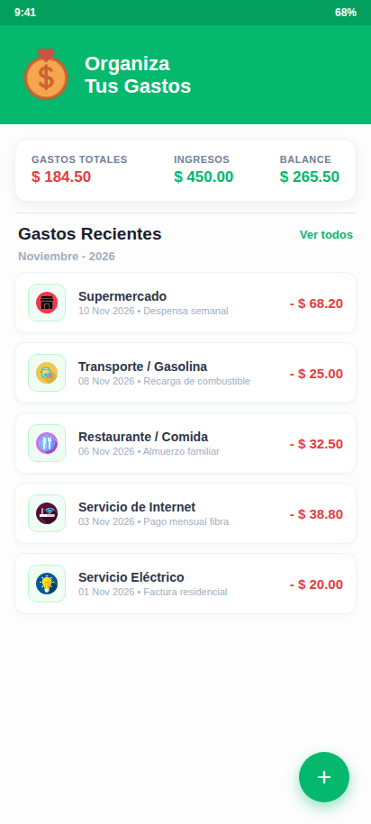
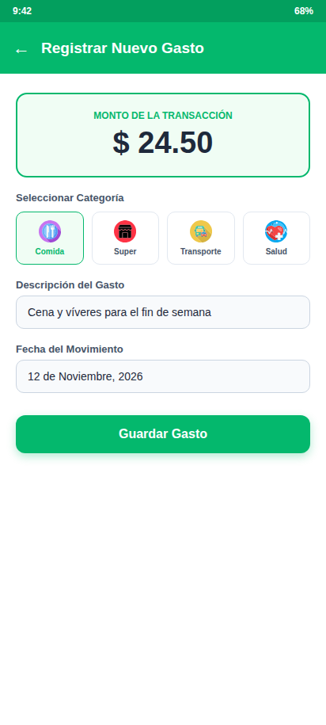
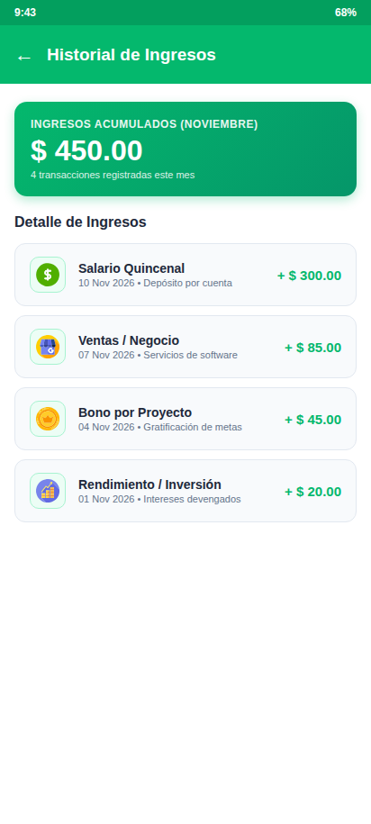

# Cuida tu Cora

> Aplicación móvil multiplataforma para el control de finanzas personales, gestión de presupuestos y registro de transacciones diarias.

[](https://flutter.dev)
[](https://dart.dev)
[](https://flutter.dev)
[](#arquitectura-y-diseño)
[](#persistencia-de-datos)
[](LICENSE)

---

## Capturas de Pantalla

| 1. Dashboard Principal | 2. Registro de Gasto | 3. Historial de Ingresos |
| :---: | :---: | :---: |
|  |  |  |
| **Resumen mensual, balances y categorías** | **Selector dinámico de categorías y montos** | **Seguimiento detallado de ingresos** |

---

## Descripción del Proyecto

Cuida tu Cora es una solución móvil diseñada y desarrollada para brindar a los usuarios un control claro, rápido y visual de sus ingresos y gastos personales. El proyecto aplica principios de Programación Orientada a Objetos (POO) y una estructura de código desacoplada para garantizar escalabilidad, bajo consumo de recursos y funcionamiento local sin requerir conexión continua a internet.

Proyecto académico desarrollado en la Escuela Superior de Innovación y Tecnología (ESIT).

---

## Características Principales

* Balance Financiero en Tiempo Real: Cálculo automático e instantáneo de gastos totales, ingresos totales y balance neto con diferenciación visual de saldos.
* Categorización Gráfica: Mapeo de gastos e ingresos a iconos vectoriales en formato SVG (supermercado, comida, transporte, educación, servicios, salud, ocio, salarios e inversiones).
* Formularios de Registro: Vistas dedicadas para registrar, editar y consultar transacciones con montos, fechas y notas descriptivas.
* Persistencia de Datos Local: Almacenamiento estructurado en base de datos local SQLite para acceso rápido, seguro y disponibilidad permanente.
* Diseño Responsivo: Interfaz adaptable a pantallas de teléfonos y tabletas manteniendo consistencia visual.

---

## Arquitectura y Estructura del Código

El código fuente se organiza bajo un esquema modular que separa la lógica de presentación de la capa de acceso a datos:

```
lib/
├── database/                # Capa de persistencia y consultas SQL locales
│   ├── p_inicio.dart        # Consultas de balance y transacciones del mes en curso
│   ├── gasto_app.dart       # Entidad y operaciones CRUD para gastos
│   ├── bd_nuevogasto.dart   # Inserción y validación de nuevos egresos
│   ├── bd_nuevoingreso.dart # Inserción y validación de nuevos ingresos
│   ├── bd_editargastos.dart # Modificación y baja lógica de gastos
│   └── bd_editaringresos.dart
├── screens/                 # Capa de presentación (Vistas y Formularios)
│   ├── gastos_screens.dart  # Vista detallada de histórico de gastos
│   ├── ingreso_screens.dart # Vista detallada de histórico de ingresos
│   ├── nuevo_gasto_screen.dart
│   ├── nuevo_ingreso_screen.dart
│   ├── editar_gasto_screen.dart
│   └── editar_ingreso_screen.dart
└── main.dart                # Punto de entrada, tema global y Dashboard principal
```

---

## Guía de Instalación y Ejecución Local

### Prerrequisitos
* Flutter SDK (versión 3.10 o superior)
* Dart SDK (versión 3.0 o superior)
* Emulador Android, dispositivo físico o navegador web compatible

### Pasos

1. Clonar el repositorio:
   ```bash
   git clone https://github.com/devuek/Cuida_tu_cora-main.git
   cd Cuida_tu_cora-main
   ```

2. Instalar dependencias del proyecto:
   ```bash
   flutter pub get
   ```

3. Ejecutar la aplicación en modo desarrollo:
   ```bash
   flutter run
   ```

---

## Tecnologías Utilizadas

* Framework: Flutter (Google)
* Lenguaje: Dart
* Formato Vectorial: flutter_svg para renderizado de iconos
* Manejo Asíncrono: FutureBuilder y StatefulWidget
* Control de Versiones: Git y GitHub

---

## Autor

* Eleazar Neftalí Trejo López
  * GitHub: [@devuek](https://github.com/devuek)
  * Rol: Desarrollador Frontend Móvil
  * Institución: Escuela Superior de Innovación y Tecnología (ESIT)
